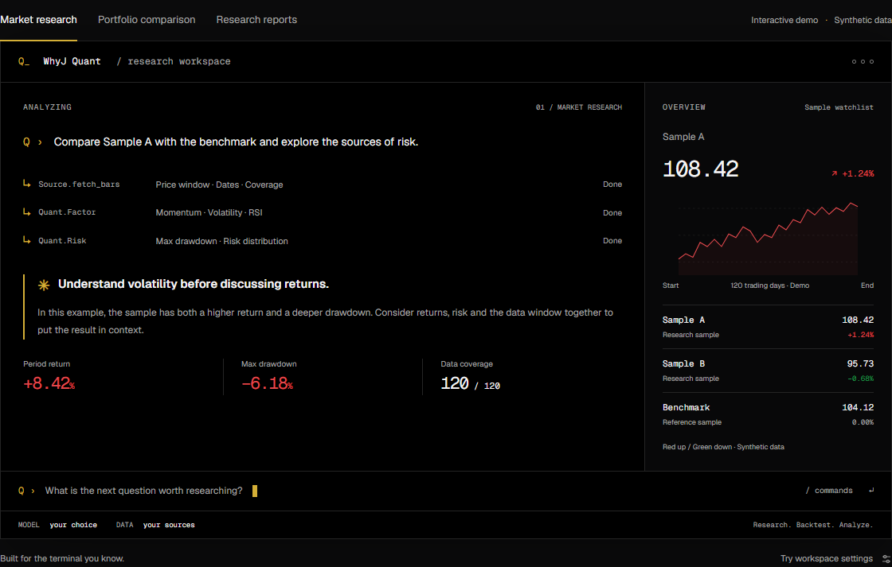

# WhyJ Quant

**Research before conviction.**

An open-source AI research terminal. Bring your own models and data sources to explore markets, test ideas, and keep a record of the evidence.

[Website](https://oh-my-quant.vercel.app/en/) · [Quick start](#quick-start) · [Docs](#documentation) · [Blog](https://oh-my-quant.vercel.app/en/blog/) · [中文](https://oh-my-quant.vercel.app)

[](https://oh-my-quant.vercel.app/en/)

*Interactive website demo with synthetic data. The CLI runs in your own terminal.*

## Features

- **Research in context.** Ask questions in natural language; connect market data and quantitative tools in one conversation.
- **Test the idea.** Explore factors, backtests, and risk metrics with explicit date windows and data coverage.
- **Keep the evidence.** Review Dashboard reports and tool-call trajectories, then resume the source research.
- **Make it yours.** Choose models, data providers, skills, market colors, and workspace preferences.

## Quick start

Install the [published package](https://www.npmjs.com/package/whyj-quant), then launch the terminal:

```sh
npm install -g whyj-quant
whyj
```

Open `/config` to connect your model and market-data providers. Use `/doctor` to check the setup, then ask a question:

```text
Analyze the returns and risk of 000001.SZ from 2025-01-06 to 2025-06-30.
Show the actual data source, coverage dates, assumptions, and missing inputs.
```

To save reports, enable **Auto Artifacts** in `/config` before submitting a research request. `/artifact` opens existing reports; `/resume` returns to a saved session.

Provider credentials and optional Python dependencies depend on your data sources. Model and data services may charge for usage. See the [configuration guide](./docs/configuration.md) and [provider reference](./docs/source-data-providers.md).

<details>
<summary>Run from source</summary>

With Bun installed, run from the repository root:

```sh
bun install
bun run src/index.ts
```

The checkout and npm release may differ. Check `whyj --version` and the [changelog](./CHANGELOG.md) for the version you are using.

</details>

## Commands

| Command | Purpose |
| --- | --- |
| `/config` | Connect models and data; adjust the workspace |
| `/doctor` | Check the research environment |
| `/portfolio` | Manage observation groups |
| `/skill` | Discover and inspect skills |
| `/artifact` | Browse reports and restore their source research |
| `/resume` | Continue a saved session |

Use `/help` in the terminal or `whyj --help` in your shell. The [command reference](./docs/slash-commands.md) covers the full interface and one-shot usage.

## Documentation

| Start here | Explore further |
| --- | --- |
| [Configuration](./docs/configuration.md) | [Module architecture](./docs/module-architecture.md) |
| [Data providers](./docs/source-data-providers.md) | [Agent loop and harness](./docs/pi-agent-loop-harness.md) |
| [Reports and artifacts](./docs/artifacts-design.md) | [Design system](./DESIGN.md) |
| [Tools and skills](./docs/trader-skills.md) | [Investment reading notes](./notes/README.md) |

The website is available in [English](https://oh-my-quant.vercel.app/en/) and [中文](https://oh-my-quant.vercel.app). Most technical references are currently in Chinese. Future articles will appear on the [Blog](https://oh-my-quant.vercel.app/en/blog/).

## Development

```sh
bun run typecheck
bun run check:architecture
bun run test
bun run build
```

The product website lives in [`site/`](./site/README.md) and has its own build:

```sh
bun run --cwd site dev
bun run --cwd site build
```

## License

[MIT](./LICENSE). Built for thoughtful research.

Research software, not investment advice. Observation groups are not brokerage accounts. Settings, sessions, and reports are stored locally; analysis sends necessary requests to your chosen providers. Review reports before sharing them.
