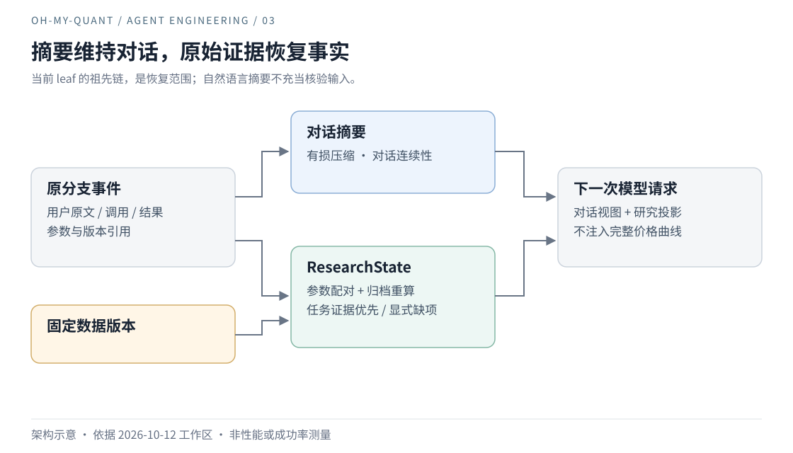

# 03｜压缩对话之后，研究事实从哪里回来

Agent Engineering / oh-my-quant · 初稿 2026-10-12 · 修订 2026-10-13 · 上下文与恢复

“继续刚才的比较。”对用户来说，这是一个自然的续问。对研究 Agent 来说，它要求找回的不只是一句话，还有那句话成立时的输入。

## 续问需要找回的，不只是一句话

早期 context 设计保留 `last_symbol`、最近工具和结果形状。这些线索很实用：它们能帮助理解「这只股票」「换个窗口」，避免用户每次重新描述对象。

而一项跨天继续、需要导出报告的研究，还依赖权重、币种、日期、基准、费用和数据版本。如果摘要记得「组合 A 优于 B」，却遗漏比较区间，那么语言是连贯的，研究依据却可能已经改变。

因此，问题不在于能否保存更多聊天记录，而在于：经过压缩以后，哪一部分信息仍然足以支持原来的判断？

## 最近发生的，不一定是最重要的

Anthropic 的上下文工程讨论强调有限注意力下的信息选择，Manus 则讨论借助外部存储恢复上下文。这些方法都提醒我们不必把一切塞回窗口；但对 WhyJ，保存一个路径或一句摘要仍不够，还要知道它对应哪份输入。[Anthropic](https://www.anthropic.com/engineering/effective-context-engineering-for-ai-agents)、[Manus](https://manus.im/blog/Context-Engineering-for-AI-Agents-Lessons-from-Building-Manus)

项目里有一个更具体的反例：任务先由较早的回测满足条件，随后又执行八次不同本金的回测。任务仍显示 complete，模型上下文却只保留最近六次操作，原验收证据被挤掉了。

这次丢失并不完全来自摘要。选择规则把「最近发生」当成了「当前最重要」，因此即使摘要写得更好，也没有修复证据优先级的问题。[反例与修订](../quant-harness/README.md#research-state)

<a id="context"></a>

旧 CLI 文档一度把 compact 描述为不消耗模型的启发式压缩，还把 slash 一概视作不触发模型的本地动作。两句话都越过了实际机制：当前压缩调用模型，显式模型诊断也会产生请求。因此淘汰的是这两项保证，而不是把它们换个说法继续归档成参考规范。轻量续问线索仍有价值，却不能因此升级成事实账本；用户需要在执行前知道压缩的延迟与用量，而非事后才发现成本。

## 让摘要和研究状态成为两种投影

当前会话 JSONL 是带 `parentId` 与 leaf 的追加树。压缩写入 compaction 记录，改变发给模型的消息视图，但原分支事件仍然保留。ResearchState 沿当前 leaf 的完整祖先链重建，不扫描其他分支，也不从压缩后的聊天文本倒推事实。



*图 3：摘要维持交流，结构化状态恢复研究依据；两者消费同一历史，却承担不同保证。*

一条模型文本说「最大回撤为 8%」，不会直接变成已核验发现。系统先配对调用与结果，检查工具名、调用 ID、参数及顺序，再读取固定数据，重算支持的指标。概念上：

```text
研究状态 = 投影(
  当前分支的调用与结果,
  固定版本的公开观察,
  参数匹配与可支持的重算规则
)
```

投影区分 pending、failed、unverified、verified，也保留管理动作的 recorded。成功编辑观察组合可以被记录，但它并不因此成为投资结论。核验逻辑放在独立 `research/`，由会话和报告共用，避免两处「已核验」采用不同标准。

接着修正选择规则：先放入当前任务条件绑定的证据，再合并近期操作和未解决项；任务报告也优先于普通最近报告。达到预算上限时明确给出省略计数，而不是悄悄让上下文看起来完整。

恢复还要处理失效。如果原 DatasetRef 的归档丢失，系统保留范围与引用，但撤销相应核验发现；任务可能从 complete 回到 blocked。旧事件不改写，今天还能不能支持它，则重新判断。切换会话也先准备资源，再提交 leaf 和活动状态，准备失败时保留原会话。

## 恢复材料之后，问题还没有结束

已有恢复回归故意让摘要遗漏参数，检查下一次实际 Pi 请求仍包含重建字段；针对较早任务证据的回归，则验证它不会被后续无关回测挤掉。它们证明的是材料恢复和选择机制，不是模型解释已经获得普遍正确性。[结构化任务与验收](../quant-harness/README.md#tasks)

我们为此承担了三类成本：模型压缩有延迟与用量，固定数据需要持续保留，研究投影需要匹配、重算和失效处理。当前预算还是数量与字符上限，不是精确 token 调度器；更长历史与更大组合的重算时延，也不能用「结构化」一词带过。

因此，对短问答，这套机制可能过重。对明天还要重新打开、说明输入来源的研究，单纯保存最终回复又明显不够。判断边界的方法不是问「需要多强的记忆」，而是问「恢复后必须重新证明什么」。

这也是本次淘汰旧 context 正文时留下的反思：不能因为旧方案更轻，就继续让它承担没有定义过的保证；也不能因为新方案更完整，就宣称记忆问题已经解决。下一步要测的是模型如何使用恢复材料，而不是再证明材料已经存在。

## 实现索引

- [状态与模型投影](../../src/research/state.ts)、[任务条件](../../src/research/tasks.ts)。
- [恢复回归](../../src/agent/test/research-recovery.test.ts)、[任务证据回归](../../src/research/test/tasks.test.ts)。
- [研究状态契约](../quant-harness/README.md#research-state)与[结构化研究任务](../quant-harness/README.md#tasks)。

[← 上一篇](./02-data-contracts.md) · [下一篇：工具和 Skill 越多，Agent 就越强吗 →](./04-capability-and-skills.md)
