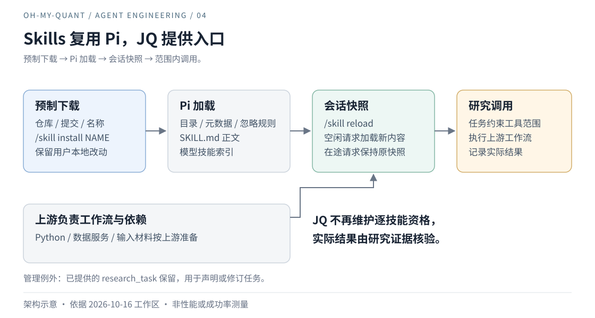

# 04｜工具和 Skill 越多，Agent 就越强吗

Agent Engineering / oh-my-quant · 初稿 2026-10-12 · 修订 2026-10-13 · 能力治理与扩展

增加工具通常能扩大可做的事情。问题是，模型看见了一项能力，并不意味着当前环境能够执行它，也不意味着用户允许它在这次任务中执行。

## 模型应该看见哪些能力？

在工具较少时，一张 registry 很容易理解：名字对应 schema，schema 对应执行函数。再把 Skill 加入提示词，模型就有了怎样组合这些工具的说明。

随着研究范围扩展，这个起点开始遇到真实限制。数据工具依赖凭证和端点，脚本依赖 Python 与文件，Skill 还可能要求宿主根本没有的搜索或工作区能力。与此同时，用户只想完成一个有对象、有窗口、有边界的任务。

因此，我们需要回答的已不只是「仓库里有哪些工具」，而是「这一轮可以向模型承诺哪些能力」。

## 已经安装，却不一定可以调用

例如，工具可以注册成功，却因缺少 Python 无法运行；Skill 可以安装成功，却引用当前宿主没有的服务；某个动作在技术上可执行，却超出用户限定的对象。它们都可能表现为「Agent 不会用工具」，但继续修改同一段 prompt，不会同时解决这三种原因。

「清理无关 Skill」也有这种歧义。删除磁盘文件、关闭外部发现、精选默认入口、限制当前任务模式，是不同操作。若只看用户机器上是否存在某个目录，就把里面的全部指令加入研究能力，等于让安装环境替用户决定任务范围。

更隐蔽的冲突发生在资源更新时：新 Skill 已经进入索引，旧工具还在运行；或者任务排除了 bash，依赖 shell 的 Skill 仍被描述为可用。各份清单独立看都合理，组合起来却没有可执行的含义。

还有一次，用户已经给出研究材料，Skill 也选中了正确的 risk health 工作流，通用提示却继续要求先建立价格研究任务。模型于是填出空基准和并不存在的 supplied_snapshot_audit 验收工具。我们原先把统一的“价格→因子→风险”顺序当作质量保障，它却把材料解释挤进不相容的任务类型。错误不在工作流没有读到，而在宿主预先规定了所有研究都必须长成同一种形状。

<a id="readiness"></a>

资格检查本身也犯过类似错误：包元数据存在、版本满足，就被当成 Python 依赖可用。实际导入仍可能因 DLL 或传递依赖失败。2026-10-13 的回归把这个误判变成失败用例，之后才分开“版本已查”和“同一解释器确实导入成功”。这不是安装器更聪明就能代替的判断，因为安装事务与运行环境有不同的失效条件。

## 从工具清单到有条件的资源快照

WhyJ 分开维护四个判断：registry 说明工具是什么，readiness 说明已知依赖与限制，probe 提供指定端点和参数的观察，ResearchTask 声明这项工作允许使用什么。



*图 4：可见资源限制与执行检查相互补充；就绪证据仍有范围，不能预判所有外部调用成功。*

请求准备时，一个简化关系是：

```text
业务工具集合 = 宿主活动工具 ∩ 任务允许工具
Skill 运行模式 = 这份工具集合与依赖证据能够支持的模式
```

这里有一个必须说清的例外：宿主若提供 `research_task`，它作为任务管理通道继续可见，不受业务工具白名单过滤；任务取消后也要保留它，才能声明新任务。管理事件仍有自己的校验，不等于绕过范围执行行情或交易。

只缩小可见集合还不够，所以执行前再次核对工具、对象和窗口。前一层减少无关选择，后一层处理模型仍提出越界动作的情况。两者都不构成第三方代码沙箱，宿主回调与扩展仍是受信任代码。[任务装配与守卫](../quant-harness/README.md#tasks)

Skill 则按运行模式声明依赖。精选 catalog 固定来源版本，安装器检查本地修改、准备更新并在失败时保留已有内容；readiness 另行核对工具、解释器、文件闭包或有限网络观察。完整数据模式不可用时，用户提供证据的受限模式可能仍可用，但回答不能把后者描述为前者。[安装契约](../quant-harness/trader-skills.md#installation)、[依赖契约](../quant-harness/trader-skills.md#readiness)

因此 `--check` 的版本与文件结果不再独自授予需要 Python 包的模式运行资格；显式 `--check-imports` 在同一实际解释器中加载声明的包。导入成功仍不能覆盖文件漂移、网络或授权。它增加了检查步骤，也意味着不同证据会各自过期，系统必须能够撤销曾经给出的资格。

扩展带来的 tools、skills、capabilities 共同进入带 revision 的资源快照，准备成功才提交，准备失败保留旧资源。在途循环和排队续问保持原快照；任务约束另生成请求级子集。

任务入口也因此改为先区分意图：需要受支持计算和固定数据验收时，读取真实 acceptanceTools 再声明；只是解释明确提供的材料时，保持 limited-evidence 边界，不编造一个核验器。已有任务不能被这种分流悄悄重置。代价是路由不再只有一条，而判断也仍可能失误；共享工具目录能消除虚构名称，却不能独自证明模型理解了用户。

Manus 讨论过工具定义变化对缓存与历史一致性的影响。这里借鉴的是对变更成本的警惕，不是复制其解码屏蔽机制；WhyJ 没有实现或测量同等的 KV-cache 收益。[Manus 原文](https://manus.im/blog/Context-Engineering-for-AI-Agents-Lessons-from-Building-Manus)

## 少承诺一点，就要多维护一点

任务装配与守卫已有回归，固定 Skill 评测也保留了工作流选用、受限模式和回答错误的记录。它们能证明某个范围内资源一致、越界动作被拦截，不能证明工具集合变小后，所有研究都更快或更准确。[Skill 评测及限制](../quant-harness/evaluation.md#skills)

代价是清单不再只维护一个函数名。固定版本、文件闭包、模式依赖与资源 revision 都需要更新；上游 Skill 变化时，旧检查可能不再适用。无法可靠确认的能力必须保留 unverified，这会比「全部 ready」显得保守。

图表技能的检查器也曾把合法的 PowerShell reference 读取挡住。修正允许的读取形态之后，还要区分“预览前 60 行”和“完整读完要求的三份 reference”；命令放行不是内容消费证据。这个反例提醒我们，检验器失配不能被归为技能本身失败，修好检验器也不能反过来证明任意 shell 已安全。

一次验证还提醒我们不要跨越环境边界：GitHub raw 下载超时后，隔离验证改用本地已有的同一固定 Git 对象，继续检查脚本与公开 CSV。缓存源码下的路径可以通过，但它既不证明 GitHub 已恢复，也不证明用户另一个 checkout 已就绪。[当时的导入观察](../../output/skill-python-import-observation-2026-10-13.json)与[缓存源码路径回执](../../output/breadth-script-import-gate-cached-2026-10-13.json)保留在本地输出；这不是把失败环境换掉以后，宣布原环境修好。

扩展分发也做了类似选择：WhyJ Extension API 1 用静态 import 显式加载，先验证独立扩展能够接入，再扩大分发范围。它更容易审查依赖，却没有直接安装 Pi 原生扩展的兼容性。[扩展设计](../agent-runtime/extensions.md)

这次整理撤下旧工具数量和重复注册说明，并不是因为数量毫无意义，而是它无法回答最重要的问题：模型被告知能做什么，这一轮实际又能做什么。后续若固定任务仍反复误选，就该调整工具粒度或说明；若失败来自缺依赖，就补依赖契约。继续增加注册项，不应该成为这两类问题的默认答案。

## 实现索引

- [任务装配与守卫](../../src/runtime/quant-harness.ts)、[工具能力投影](../../src/runtime/data/tool-readiness.ts)。
- [技能 catalog](../../src/skill/catalog.ts)、[技能 readiness](../../src/skill/readiness.ts)、[会话端口](../agent-runtime/README.md#dependencies)。
- [模块所有权的取舍](./01-own-the-harness.md#ownership)与[现行 Harness](../quant-harness/README.md)。

[← 上一篇](./03-context-as-projection.md) · [下一篇：测试全绿，为什么仍然不能交付一个结论 →](./05-evaluation-beyond-green.md)
