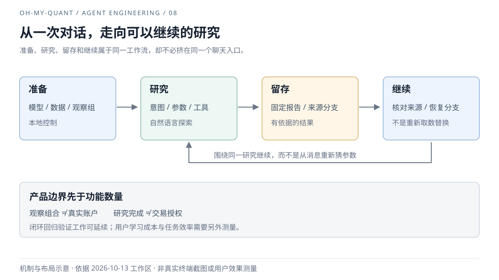

# 08｜研究终端，为什么不能只是一个聊天框？

Agent Engineering / oh-my-quant · 初稿 2026-10-13 · 修订 2026-10-13 · 产品定位与工作流

用户今天比较两组标的，明天再问“换一个基准会怎样”。对话可以接着说，但研究是否真的接得上？这个差别决定了 oh-my-quant 应该围绕消息设计，还是围绕持续进行的工作设计。

## 用户离开以后，什么应该留下？

聊天是一个合适的研究入口。用户不必先理解因子函数或工具参数，就能提出一个尚不完整的问题，再通过追问补齐日期、对象和比较口径。自然语言承担探索，而不是要求用户在第一步就填完所有表格。

但用户离开之后，需要留下的不只是一段回答。下一次研究还需要知道：比较了哪两组标的，采用什么日期、权重、币种和基准，当时的数据是否仍然可核验。这些信息如果只能从聊天文字中重新猜测，连续对话就不等于连续研究。

[PRD](../quant-harness/PRD.md)因此把主要工作串成“配置 → 获取数据 → 分析与比较 → 报告 → 恢复”。从产品设计看，这条链比功能清单更有约束力：报告不是最后多一个导出按钮，而是下一次研究的入口。

## 功能都在，工作仍可能接不上

已有的终端验收记录提供了一条很具体的路径：在界面开启自动报告，创建两组观察标的，输入带日期、基准和币种的比较请求，完成计算，再通过 `/clear` 重置当前研究会话（保留磁盘存档），从报告恢复。测试必须经过这些入口，而不能直接调用比较函数代替用户完成工作。[键盘流程回归](../../src/tui/test/research-workflow.test.ts)保留这条可重复路径。

这里有一个容易被功能统计掩盖的冲突：单独的“创建组合”“运行工具”“生成 HTML”都能成功，组合起来仍可能丢失来源会话，或者在恢复时重新取一份不同的数据。局部能力存在，并没有回答用户是否能够接着昨天的工作往下做。

对象名称也会改变承诺。Portfolio 听起来像一个账户，但默认 Portfolio 管理的是观察标的与分组，不持有用户的实际股数、成本或现金。把它展示成“我的资产”，会让公开行情与模拟结果承担并不存在的账户含义。这个限制不应只藏在技术文档里，而应进入帮助、字段和报告用语。

## 把探索、控制和留存放在不同位置

当前产品把自然语言交给研究过程，把配置、诊断、组合维护和恢复交给明确的本地入口。Analyzing 展示研究，Overview 提供观察背景，Composer 承接意图，报告保存一次有来源的结果。它们服务同一条工作流，却不要求用户在同一个聊天流里完成所有事情。

*图 8：产品工作流示意，不是逐屏操作截图。箭头表示工作如何延续；报告可打开、来源可恢复、证据可重算仍须分别检查。*

这一选择也可以放在三种产品组织方式之间理解。下表是对当前方案的分析，不是对历史方案会议的还原。

| 组织方式 | 对用户的帮助 | 留下的成本 |
|---|---|---|
| 只围绕聊天 | 自由提问，入口轻 | 状态与对象容易埋进历史，需要反复说明 |
| 只围绕固定表单 | 参数和步骤明确 | 尚未成形的问题难以表达，新研究容易要求新表单 |
| 研究对话配合本地控制与报告 | 探索可以开放，关键动作有确定入口 | 用户要理解几类对象，团队要维护跨入口一致性 |

因此，“少几个页面”并不是这里唯一的简化标准。更重要的是用户是否还需要反复搬运同一份参数，是否知道下一步在研究、修改设置，还是恢复一份旧结果。第 [11 篇](./11-discoverable-interactions.md)讨论这些入口怎样被发现，第 [12 篇](./12-recovery-as-ux.md)讨论它们失败后怎样继续。

实盘执行没有被塞进这条默认研究链。研究完成不能继承下单授权，真实账户业绩也不能由观察组合估算。执行端口与私有账户输入各有独立契约；这缩小了默认产品的承诺，也意味着用户不能把它当作完整交易工作站。[执行边界](../quant-harness/execution.md)、[账户业绩](../quant-harness/performance.md)

## 闭环已经可走，价值还需要测量

最早的连续回归采用本地固定模型响应与合成行情，验证键盘到存储、报告和恢复的链路。后续记录再加入空配置路径，以及隔离生产 PTY 下的真实模型、公开行情、双组合比较和恢复。2026-10-09，F05 的本地布局与工作流范围完成验收；这些证据不能合并成“首次真实账号开通到任意研究均已通过”。现行范围由 [PRD](../quant-harness/PRD.md)维护，本轮未重新执行上述阶段验证。

我们得到的是一条可以检验的产品链，而不是用户价值已经成立的统计结论。固定任务能完成，不说明初次使用者能够独立发现它；恢复事实正确，也不说明模型一定解释正确。

下一轮产品验证应围绕完整任务记录：第一次配置在哪里停住，比较时哪些参数反复补问，隔天恢复是否需要重新组织材料。完成时间、回退次数和独立完成比例都是待测指标，目前没有统一用户研究基线，不能填入一个看似漂亮的提升数字。

这也给功能扩张一个判断条件：新增能力是否减少了研究链上的真实中断，还是只让演示多出一个按钮。后者不必一律拒绝，但不应与前者混用同一种价值声明。

## 实现索引

- [产品范围与完成度](../quant-harness/PRD.md)、[观察组合服务](../../src/runtime/research/portfolio.ts)。
- [连续键盘流程回归](../../src/tui/test/research-workflow.test.ts)。
- [报告与恢复契约](../quant-harness/artifacts-design.md)、[界面职责](../quant-harness/quant-uiux.md)。

[← 上一篇](./07-artifacts-and-boundaries.md) · [下一篇：模块边界 →](./09-boundaries-for-change.md)
