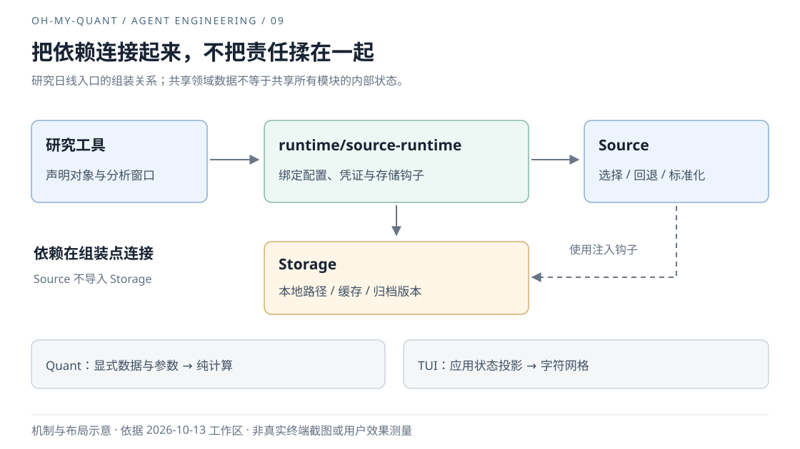

# 09｜模块拆开以后，为什么还需要一层 Runtime？

Agent Engineering / oh-my-quant · 初稿 2026-10-13 · 修订 2026-10-13 · 技术架构与变化成本

把取数、存储、计算和终端分到不同目录，只完成了架构工作的第一步。真正的考验是：换一个供应商、接一个工具，或者改变一种展示，究竟需要哪些模块一起修改？

## 我们想让哪一种变化停在边界内？

第 [01 篇](./01-own-the-harness.md)讨论 Pi 与自有 Harness 的分工。这一篇向应用内部看：Source、Storage、Tools、Runtime 和 TUI 为什么不能简单合成一个“数据服务”？

它们确实处理同一项研究，但变化原因不同。供应商字段和回退策略属于 Source；文件路径、缓存修订与提交属于 Storage；一个因子的公式属于 Quant；输入焦点和可见行数属于 TUI。把这些变化分开，才有机会在换取数方式时保留计算，在换展示时保留研究结果。

目标不是让模块彼此不知道对方存在，而是让依赖必须经过可解释的入口。用户最初问“Source 和 tool 是隔离的吗”，也可以从这里回答：它们有职责边界，但工具仍需通过应用组装的数据入口取得配置、数据与来源；隔离不是各自维护一套配置。

## 直接调用很短，隐含依赖却会变长

一个方便的实现是让 Source 自己读取本地配置和缓存。另一个方便的实现是让 TUI 在需要报价时直接调用 provider。每条路径都很短，但它们会把宿主选择藏进较低层：取数模块开始知道 `.ohquant`，界面开始决定回退和错误分类。

当前源码采用了相反的约束：Source 和 Storage 不互相导入，TUI 不直接调用 provider，`session.ts` 不直接导入 Storage、Tools、Source 或 TUI。这些是[架构检查](../../tests/architecture/check-architecture.ts)中的具体规则，不只是模块图上的理想箭头。

规则本身仍不够。如果一次只读历史归档的请求，也必须先加载当前供应商的凭证，它虽然没有违反目录规则，却仍把两种生命周期绑在了一起。接口存在只是起点；数据路径是否会被无关的配置阻断，才是边界需要回答的具体问题。

## 在组装点连接，在计算和渲染前收敛

以需要可归档日线的研究调用为例，Tools 经 `runtime/data/source-runtime` 调用 Source。Runtime 注入设置与凭证读取、缓存、归档读取和保存钩子；Source 负责供应商选择、标准化与回退，Storage 负责本地数据版本。这条路径不是所有数据入口的统一通道：Overview 和单源诊断有各自的时效与隔离要求。

*图 9：研究日线调用与应用组装示意，箭头不是独立服务或部署单元。Source 通过注入钩子使用存储能力，不反向导入 Storage；并非所有工具都经过日线入口。*

当前 `createStorageSourceRuntimeDeps()` 的内容很朴素：把 `loadCachedBars`、`loadArchivedBarsBefore`、`saveBars` 和来源偏好读取绑定给 Source。它之所以单独存在，不是为了多一层命名，而是为了让“怎样取得数据”与“本地宿主怎样保存数据”可以分别测试。

历史观察截止是一个更具体的分叉：带 `observedBefore` 的归档读取不需要供应商，当前 Runtime 保留存储依赖注入，但不为该路径附加默认供应商请求预算或凭证加载器；未显式指定来源时，仍需读取来源偏好。普通请求才绑定默认请求预算与延迟凭证读取。数据仍来自同一个 Source 门面，但不同请求不必承担相同的外部依赖，也不能把不调用供应商误解为完全不读取设置。[取数组装实现](../../src/runtime/data/source-runtime.ts)

Session 同样使用显式宿主端口；完整注入后不隐式加载默认本地组装。这部分独立宿主与连接快照的验证已在第 [01 篇](./01-own-the-harness.md)展开，这里不把它当成另一套架构重新讲述。

纯计算与报告渲染也不是第二套业务判断中心。Quant 接收数据和参数；Research 核对归档及计算依据；Agent 恢复和 Artifact 使用共享核验逻辑，渲染器再消费准备好的结果。这样，一个来源缺失的判断不必在聊天上下文和 HTML 中各实现一次。

## 可替换不是免费的抽象

现有 [Source Runtime 回归](../../src/runtime/test/source-runtime.test.ts)覆盖设置中的凭证进入请求、异步设置读取响应取消，以及调用者可缩短但不能随意放大默认预算；还以显式来源和注入 adapter 检查坏供应商配置下的旧缓存读取。这些是具体输入下的依赖与失败契约，不证明所有来源已经可互换，也不证明未来 Web 或远程宿主无需适配。本轮核读代码与原有证据，没有重新调用供应商或运行产品测试。

代价同样具体。Runtime 要维护转换、组装和生命周期，端口要处理空集合、快照、取消与准备失败；一次端口变更可能同时影响默认工厂、独立宿主和测试替身。这不是免费获得的“解耦”。

Runtime 也有变成杂物层的风险。当前的判断方法是继续按变化来源检查：如果某段逻辑决定供应商字段，应回 Source；决定持久化提交，应回 Storage；只是连接这些能力，才留在组装层。出现稳定、独立的生命周期，再考虑抽成专门服务，而不是看到文件变长就切成任意碎片。

Alpha/AKQuant 的旧 roadmap 还留下另一种错误：早期“尚未接入”的盘点被后续文档沿用，而工作区已经存在 Alpha 模块与 Python 适配。我们纠正了现状，却没有顺势把接入写成完整验收。保留的是固定输入、成本、窗口、引擎版本和失败语义；暂不为只有一个实际实现的场景建设通用引擎平台。第二个真实引擎若暴露稳定共性，再扩大协议，代价是届时可能需要迁移第一版适配。[当前 Alpha 契约](../quant-harness/alpha-backtest.md)

反过来，独立模块已能构建，也不能证明默认 Agent 能用到它。Alpha 需要进一步检查注册表、缺依赖时的前置失败、固定数据归档和恢复链路。集成探针第一次还因为把报告的 `metadata.path` 写成 `metadata.filePath` 而失败；这要求修正检查器，不应顺手归因于引擎。扩展接入则曾因异步启动吞掉配置修复后紧接的输入，修复点是等待启动完成后提交，而非再加一层模块接口。这些具体失败提醒我们，可替换性与用户路径可达必须分别验证。

因此，这一轮架构的结果是职责和替换路径更明确，不是已经测得开发效率提高。下一步可以记录新接一个 provider 或工具实际改动哪些模块、哪些回归必须一起变化。若多个本应独立的变化总要跨越同一组文件，现有边界就值得重新审视。

## 实现索引

- [模块架构](../quant-harness/module-architecture.md)、[依赖约束](../../tests/architecture/check-architecture.ts)。
- [Source 组装](../../src/runtime/data/source-runtime.ts)、[Source 公共入口](../../src/source/index.ts)、[存储规则](../quant-harness/ohquant-storage-policy.md)。
- [Session 端口](../../src/agent/src/session-contracts.ts)、[独立宿主回归](../../src/agent/test/session-dependencies.test.ts)、[共享研究核验](../../src/research/input.ts)。

[← 上一篇](./08-research-workbench.md) · [下一篇：布局与视觉语义 →](./10-layout-and-visual-language.md)
