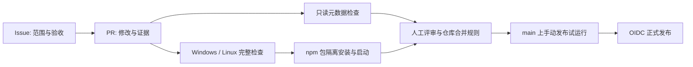

# Agent Repo 的基础建设：从工作约定到可核验的交付

初稿：2026-10-15 · 修订：2026-10-18 · oh-my-quant · 工程实践补篇

给 Agent 一份编码原则，可以减少无关改动；要求它提交前测试，也能改善交付。但仓库一旦开始接受多个 PR、跨平台构建和包发布，维护者仍会遇到同一个问题：这次“完成”到底对应哪个问题、哪份代码，以及哪些检查？

最初为 oh-my-quant 增加 CI 和 npm 发布流程时，缺口比两个 YAML 文件更具体：Desktop 流程覆盖 Windows 安装包，却没有独立的 PR 检查入口；Issue 与 PR 主要依靠约定关联；本地构建成功，也没有独立证明 npm 包离开源码目录后能启动。后续审查多个开放 PR，又遇到了文档冲突、过期验证和正常路径测试未覆盖的状态问题。

这些经历共同指向本文的问题：怎样让问题定义、代码评审、CI、合并与发布对同一次交付负责，同时让规则保持简单、多人协作能够收敛？基础流程来自 Issue #17 的实现，评审案例固定于 2026-10-17 的提交；下面区分实际观察、外部观点与 WhyJ 分析，不将有限案例当作团队缺陷率调查。

## 先决定每一种文件负责什么

一个功能模块对应一个实现 Issue，再由一个实现 PR 交付，这是本仓库选择的工作方式。它让范围、验收和代码评审能够互相定位。跨模块的独立需求应拆分；必须跨越的集成点则在 Issue 中解释。这个约定不能证明修改足够小，也不能靠统计目录数自动判断，需要评审者确认。

文件之间的分工可以直接列出来：

| 载体 | 保存的内容 | 不应据此推断的结论 |
| --- | --- | --- |
| `AGENTS.md` | 长期原则、适用范围、规范与 Skill 入口 | Agent 必然遵守、GitHub 已禁止违规合并 |
| Issue | 复现或使用场景、模块范围、验收条件 | 已有代码实现或验证结果 |
| PR | 具体修改、文档、测试证据、风险与回滚 | 填写完整就等于行为正确 |
| Skill | 创建 Issue、实施与检查 PR 的操作步骤 | 已配置远端自动化 |
| Workflow | 事件、权限、环境、可执行检查 | 仓库规则已将结果设为 required |
| 当前 `docs/` | 当前行为与维护操作 | 过去每次运行都可复现 |
| 技术博客 | 问题、取舍、机制与证据限制 | 替代当前维护规范 |

这也解释了为什么不把所有内容都堆进 `AGENTS.md`：Issue 的进度会变化，测试输出属于某个修订，发布凭证属于外部配置。它们的生命周期不同，集中复制会造成多处事实不同步。

## 两个参考仓库怎样分配检查责任

本篇读取了 OpenAI Codex 的 `81aee8c86ba25` 和 DeepSeek Harness 的 `571902028a75`，以下链接固定到这些提交。公开工作流能说明代码中的触发、权限与检查关系；我们没有检查它们的私有凭证、组织 ruleset，也没有据此声称每项检查都是实际生效的合并条件。

Codex 将合并前检查集中到 `blocking-ci.yml`，通过可复用工作流执行 Bazel、Rust、SDK、仓库规则等检查，最后由 `CI required` 汇总依赖结果。汇总任务即使遇到上游失败也会执行，避免依赖失败后只留下一个跳过的结果。工作流说明还区分了 PR 的合并候选检查与合并后的完整跨平台检查。这种拆分服务于反馈时延与覆盖范围之间的取舍，不意味着每个小仓库都需要同样的矩阵。[汇总入口](https://github.com/openai/codex/blob/81aee8c86ba2549e53f82ea56f163c3e450fb55a/.github/workflows/blocking-ci.yml) · [检查策略](https://github.com/openai/codex/blob/81aee8c86ba2549e53f82ea56f163c3e450fb55a/.github/workflows/README.md)

它的 Issue 自动化还有另一层分工：模型生成分类建议，后续任务负责应用标签；重复问题检测生成候选提示，供人判断是否重复。这里值得借鉴的是把判断输出与仓库写操作分开，并分别声明权限。自动分类不应被当作代码通过验收的证据。[标签流程](https://github.com/openai/codex/blob/81aee8c86ba2549e53f82ea56f163c3e450fb55a/.github/workflows/issue-labeler.yml) · [重复问题提示](https://github.com/openai/codex/blob/81aee8c86ba2549e53f82ea56f163c3e450fb55a/.github/workflows/issue-deduplicator.yml)

DeepSeek Harness 把 Issue policy 与 Issue lifecycle 分成两个工作流。前者读取可信默认分支的策略并验证符合条件的 PR；后者处理项目状态迁移。当前策略区分普通引用与关闭引用：普通引用建立上下文，关闭引用还可能触发 Project Priority 的核对。因此，它并没有采用本仓库“一份 PR 只关闭一个实现 Issue”的完整规则，不能把两者写成同一种制度。[Issue 管理说明](https://github.com/deepseek-ai/deepseek-harness/blob/571902028a75c64c1d767f4ae5fd099485f0ddf0/.github/issue-management/README.md) · [只读策略检查](https://github.com/deepseek-ai/deepseek-harness/blob/571902028a75c64c1d767f4ae5fd099485f0ddf0/.github/workflows/issue-policy.yml) · [生命周期处理](https://github.com/deepseek-ai/deepseek-harness/blob/571902028a75c64c1d767f4ae5fd099485f0ddf0/.github/workflows/issue-lifecycle.yml)

它的 PR 模板在每种测试方法下面保留 Proof 区域，让结果跟着验证方法出现。CI 则拆出静态检查、覆盖率、消费者兼容性和 Windows 原生行为等任务，再汇总成稳定的结果名称。这样的设计有一个实际好处：测试命令、它覆盖的行为和可复核输出更容易对应。[PR 模板](https://github.com/deepseek-ai/deepseek-harness/blob/571902028a75c64c1d767f4ae5fd099485f0ddf0/.github/pull_request_template.md) · [PR CI](https://github.com/deepseek-ai/deepseek-harness/blob/571902028a75c64c1d767f4ae5fd099485f0ddf0/.github/workflows/ci.yml)

oh-my-quant 当前没有必要引入模型分诊、Project 同步或大型 runner 调度。我们先建立一条可解释、可运行的最短流程：

图中流程表示责任关系。合并规则和 npm Trusted Publisher 需要维护者在平台配置；工作流文件不会自动替他们完成设置。

## 合并之前，分别确认冲突、行为与验证

2026-10-17 的评审从三份开放 PR 开始：#35 替换社区技能与 MCP 的接入方式，#28 统一视觉设计，#27 增加本地研究工作台。它们各有目标，但是否可交付还取决于代码、基线和证据是否指向同一份系统。

### 一个文档冲突，暴露了不同的“当前版本”

审查开始时，本地主工作区还在 `b0b55db`，有大量未提交修改。远端 API 返回的 main 已是 `076b78661e61660e4e1c8b0cf7830f72714615e5`。如果直接在主目录运行测试，结果会混入尚未进入 PR 的代码。因此，本次以远端 SHA 为准，核对本地对象，并在独立 worktree 检查；Git HTTPS 拉取失败，没有被写成一次成功同步。

| PR | 审查 head | 相对远端 main | 本轮关键观察 |
| --- | --- | --- | --- |
| [#35](https://github.com/yangjingo/oh-my-quant/pull/35) | `183559c` | 落后 0、领先 2 个提交；无文本冲突 | 最终 head 的跨平台 CI 成功，局部回归 28 项通过 |
| [#28](https://github.com/yangjingo/oh-my-quant/pull/28) | `a3bb573` | 落后 19、领先 2；docs/README.md 冲突 | 描述仍将 `10184e1` 称为最终实现，之后又追加了站点和图片变更 |
| [#27](https://github.com/yangjingo/oh-my-quant/pull/27) | `999ce68` | 落后 19、领先 15；docs/README.md 冲突 | 审查时无 GitHub checks；工作台测试通过，另有元数据反例 |

两个冲突都包含文档导航中的手工文件计数。main 新增了维护说明，视觉分支改变了素材集合，工作台分支新增了功能文档。直接保留任意一侧，都可能漏掉另一侧的信息。这说明公共导航是协作热点；每次增加文档又维护一份总数，会制造与功能无关的冲突。

这里可以做一个小改进：导航维护入口与职责，统计交给工具。它只减少无意义的共享编辑，不能消除正常的功能集成。本次 skill 和博客更新也采用这一原则，保留导航覆盖检查，撤掉易漂移的手工文件总数。

#28 还提醒我们，PR 是会变化的容器。旧提交的全量测试和截图有历史价值，但不能自动覆盖后加的改动。本次在 `a3bb573` 重新跑了类型检查、12 项颜色/可读性测试及站点构建，均通过；这些结果仍不能补齐 Windows 安装和实际运行验收。其红色 PR policy 日志显示缺少 `.github/scripts/pr-policy.mjs`，应按检查基础设施问题处理，不能据此宣称视觉代码有 bug。[失败运行](https://github.com/yangjingo/oh-my-quant/actions/runs/38918415702)

### 测试通过的工作台，仍会丢掉项目编辑

#27 的研究主链已有较完整的保护：真实 Pi 循环的本机模拟、取消与继续、固定证据、不可变保存及重启恢复。本轮工作台的 28 项测试全部通过。问题出在新增的另一条状态通路：项目名、置顶和研究标题等元数据。

浏览器读取整份 metadata，在内存修改，再把整份对象写回。服务端调用 `atomicWriteJson` 替换文件。原子写可以避免半个 JSON 落盘，却没有判断客户端是否基于过期版本编辑。[浏览器读取与保存](https://github.com/yangjingo/oh-my-quant/blob/999ce68a5ce5dd951a4121cdef70421cadcde038/src/app/research-workspace/web/app.js#L31) · [服务端存储](https://github.com/yangjingo/oh-my-quant/blob/999ce68a5ce5dd951a4121cdef70421cadcde038/src/storage/src/workspace-meta.ts#L84)

用同一份文件模拟两个标签页即可复现：A、B 先读相同快照；A 新增一个项目并保存；B 重命名原项目并保存。最终文件只剩原项目，A 的新增项消失。两次写入都成功，JSON 也完全有效。这不需要多人账户，同一用户打开两个标签页就足够。修复需要明确的过期编辑策略，例如版本校验并提示刷新，或以项目为单位的更新；只在最后写文件时加锁，仍然会覆盖旧快照。

第二个反例发生在读取失败。该 head 的实现把解析异常统一转换成空项目列表。再进行一次正常编辑，就会用新对象替换原来的损坏文件。本地使用临时截断 JSON 复现时，没有抛错，原始字节也未保留。[异常处理位置](https://github.com/yangjingo/oh-my-quant/blob/999ce68a5ce5dd951a4121cdef70421cadcde038/src/storage/src/workspace-meta.ts#L69)

这两项都是新代码引入的可确认问题，影响的是项目元数据，不代表不可变研究快照也被覆盖。主线已有的 [durable-json](https://github.com/yangjingo/oh-my-quant/blob/076b78661e61660e4e1c8b0cf7830f72714615e5/src/storage/src/durable-json.ts) 会区分文件不存在与文件非法，并提供内容修订标识。值得审查的地方是新通路为什么没有接上已有契约，而不是再设计一个通用存储框架。

**WhyJ 分析：** 本次最值得警惕的是，界面增加一个看似辅助的小功能时，顺带创建了一套新的状态读写规则。研究证据受到严格保护，并不会自动保护项目编辑。review 要沿实际状态通路追到恢复行为，测试数量无法替代这条因果链。

### 把外部经验缩成适合自己的审查方法

Anthropic 的 [How the Claude Code team does code review](https://claude.dev/blog/solving-code-review-at-anthropic/) 强调持续验证、核实发现、减少噪声、审批绑定具体提交，并让复审逐渐聚焦增量。它还用事故样本和干净样本评估 reviewer。本文借用这些机制，不照搬其人工审批人数或自动合并策略；公司自述的成效也不构成本团队的效果证明。

[Hacker News 讨论](https://news.ycombinator.com/item?id=50122951) 补充了一个重要分歧：jonahx 担心按需生成局部解释会削弱共享的因果理解；csallen 则认为测试、版本控制及可理解代码仍能支持调试与恢复。这些是参与者观点，没有形成实验结论。本文选择保留一条可操作的要求：评审者应能解释受影响状态由谁拥有、失败在哪里显现，以及如何恢复。无需每个人理解全部实现，但关键交接不能只剩一句“AI 说没问题”。

Google 的 [The Standard of Code Review](https://google.github.io/eng-practices/review/reviewer/standard.html) 将整体代码健康和持续改进放在一起考虑；[Small CLs](https://google.github.io/eng-practices/review/developer/small-cls.html) 则强调自包含的变更，而非只看行数。这对本次案例很实用：#35 改了 138 个文件，其中大量是撤销重复实现；#27 只有 22 个文件，却同时增加宿主、页面和元数据行为。文件数不能直接排序审查风险。

我们据此把审查分成三个问题：Git 能否组合文本；组合后行为是否满足契约；最终版本有没有足够的验证。它们分别需要合并检查、调用链与反例、绑定修订的验证记录。任何一个答案都不能替其他两个作答。

这次也检查了 #35 与 #27 的候选组合：源码类型检查、架构边界、测试布局和工作台 28 项回归均通过。文档冲突仍保留，未生成最终合并提交，也未跑三份 PR 的完整组合验收。因此结论是“所检查的兼容路径通过”，没有发现组合缺陷，不能写成“三份 PR 可直接一起上线”。GitHub 的 [merge queue](https://docs.github.com/en/repositories/configuring-branches-and-merges-in-your-repository/configuring-pull-request-merges/managing-a-merge-queue) 可自动在最新 base 与前序候选上检查，但有可用性和工作流要求；本次未启用。少量 PR 先明确顺序、更新基线再验证，同样能落实这个判断。

## 质量检查要覆盖用户拿到的东西

基础 CI 调用统一的 `check:release`：类型、架构、仓库策略回归、测试组织、完整测试、构建和文档检查。Windows 使用原生 PowerShell，Linux 使用同一套可运行的脚本入口；没有把源码路径写进工作流，后续调整目录时可以继续维护 `package.json` 的命令。

第一次 Linux 运行提供了一个实际反例：CLI 的凭证回归把根路径写死为 `C:\private-paper`。Windows 上测试能走到缺少凭证的分支，Linux 却先拒绝这个非绝对路径。修正是让 fixture 通过 `resolve()` 得到当前平台的绝对路径，保留凭证断言和生产代码。扩展平台检查由此找到了测试自身的环境假设；不能把它写成产品鉴权缺陷，也不应该靠跳过用例恢复绿色。[失败运行](https://github.com/yangjingo/oh-my-quant/actions/runs/38602368594) · [修正的回归](../../src/cli/test/alpaca-paper-entry.test.ts)

构建之后还有一次包验证：`npm pack` 生成 tarball，将它安装到源码目录之外，再用 Node 执行安装包的版本命令。这个检查针对的是“仓库能启动，用户安装的包却缺文件”一类问题。它没有调用行情源或模型，也没有证明交互终端、安装脚本和所有受支持 Node 版本都正确。

文档检查同样需要明确对象。仓库已有一些历史文章链接到被忽略的 `output/` 回执；干净克隆不应该被要求带有这些本地文件。初版检查只将仓库内 `output/` 的缺失回执列为未重新验证，源码、现行文档、导航与锚点仍须存在。反例测试覆盖相邻目录、越界路径和伪装的 `output/../docs/` 路径，防止扩大豁免范围。

发布操作单独放在手动工作流里：只接受 `main` 上与清单一致的稳定版本，默认 dry run，先等待完整 CI；真正上传时使用 npm OIDC 与 provenance。发布前还运行已有 `prepublishOnly`，重新生成 insights 并执行完整 gate。这会重复部分检查，当前接受这个成本，以保持 npm 生命周期入口独立可用。以后若运行成本明显上升，可以评估直接发布已经验证的同一 tarball，但那需要额外证明制品来源与复用关系。

dry run 不验证 npm 的 OIDC 绑定；provenance 也不证明包的业务结果正确。它们分别回答包能否按流程准备、发布来源如何关联的问题。[发布操作规范](../quant-harness/ci-release.md) · [npm Trusted Publishing](https://docs.npmjs.com/trusted-publishers/)

### 合入以后，绿灯仍然有明确边界

在上述审查快照上，建议先处理具备最终提交 CI 的 #35，再让 #28 更新基线、证据和 Windows 验收，#27 修复元数据问题并补齐最终提交检查。#28 与 #27 没有发现必须依次合并的硬依赖，顺序可以按就绪程度调整。每次 main 前进后，后续 PR 都应重新确认自己的结论仍然成立。

后续按授权合入了 #35，main 前进到 `1d4488f7f006510265bc228923b3596d9dd22f36`（2026-10-17 14:59 UTC）。网络恢复后也重新 fetch 并核对了这个版本。本文前面的冲突与领先/落后数字仍属于 `076b786` 快照，不能当成合入后的实时状态；后续 PR 的修改和修复也不在这份历史判断之内。

同一个合并提交上，[通用 CI 成功](https://github.com/yangjingo/oh-my-quant/actions/runs/39043090573)，[Windows desktop 失败](https://github.com/yangjingo/oh-my-quant/actions/runs/39043090574)。失败位于共享 CLI 测试步骤：`recorded-year YTD excludes declarations backed by comparisons extending beyond its cutoff` 报 5000ms 超时，随后记录了临时文件锁路径的 ENOENT。日志证明本次运行失败；还不能证明 #35 引入回归，也不能据此认定只是 runner 偶发波动。此前 main 的桌面运行也失败过，但失败的是另一个 Python 导入测试，[旧运行](https://github.com/yangjingo/oh-my-quant/actions/runs/38917440064) 不能用来证明两者同根因。

这里有一个实际的覆盖边界：[Desktop 工作流](https://github.com/yangjingo/oh-my-quant/blob/1d4488f7f006510265bc228923b3596d9dd22f36/.github/workflows/desktop.yml) 只在符合路径条件的 main push 或手动触发时运行，并不响应 PR 事件。所以“PR 的检查通过”和“合入后的所有适用工作流通过”是两份证据。review 应记录 workflow、事件、受测 SHA、环境、状态和链接，先分类失败，再决定定位或重跑；不能用旧绿灯覆盖新失败，也不能靠反复重跑把失败记录抹掉。

合并后的另一项工作是确认依赖。[#36](https://github.com/yangjingo/oh-my-quant/pull/36) 当时仍以 `refactor/32-pi-community-tools` 为 base。虽然 #35 已交付，这个父分支及其 worktree 仍因开放依赖而保留。后续需要更新子 PR 的基线、复验，再按既有规则清理。合并按钮完成的是代码进入 main；依赖与验证记录也要随之更新。

这些观察已补入 review-skill，属于贡献者的检查方法。评审方法这一轮没有修改工作流、分支保护或自动合并策略，也没有顺带修复产品和测试问题。已有的 [取消计时问题 #37](https://github.com/yangjingo/oh-my-quant/issues/37) 与 [刷新时间戳问题 #34](https://github.com/yangjingo/oh-my-quant/issues/34) 提供了另外的测试边界案例，不能替代对这次新失败的诊断。

## AGENTS.md 保留什么，如何避免越来越长

DeepSeek Harness 的根 `AGENTS.md` 保留仓库结构、命令、持久化兼容性与测试规则，并把细节链接到所属文档；`.github/AGENTS.md` 则维护 Windows shell、平台检查归属和 runner 路由。根级约束与目录级操作要求分开，是一个可借鉴的组织方式。它还明确采用“本地做相关检查、CI 承担完整矩阵”的策略；本仓库当前要求提交前运行完整 gate，两者是不同选择。[根级说明](https://github.com/deepseek-ai/deepseek-harness/blob/571902028a75c64c1d767f4ae5fd099485f0ddf0/AGENTS.md) · [GitHub 目录说明](https://github.com/deepseek-ai/deepseek-harness/blob/571902028a75c64c1d767f4ae5fd099485f0ddf0/.github/AGENTS.md)

在本次读取的 Codex 提交中，根目录没有 `AGENTS.md`，存在局部目录说明。例如 TUI bottom pane 的文件要求改状态机时同步模块文档，并核对 Enter、换行与粘贴行为仍符合代码。这个例子说明规则可以贴近需要它的模块，不能根据通用印象补写一个不存在的根文件。[局部说明](https://github.com/openai/codex/blob/81aee8c86ba2549e53f82ea56f163c3e450fb55a/codex-rs/tui/src/bottom_pane/AGENTS.md)

我们的根文件保留两部分：先写编码原则，再写仓库写作规范与 Skill 索引。原则要求说明假设、实现简单、限制改动、定义验收；Issue 与 PR 的详细步骤放入对应 Skill。临时日志、模型推理过程、每次运行的通过数、凭证和项目进度都不进入根文件。出现稳定的目录特有规则时，再增加局部说明。

基础流程中的 PR policy 只检查可以明确执行的条件：一条规范关闭引用、真实且开放的 Issue、规定章节、`docs/` Markdown 更新，以及没有另一个遵循相同引用格式的活跃实现 PR。它读取可信基线策略，不执行 PR 中的代码。章节有文字不代表证据充分；改了 docs 不代表更新正确；单模块范围与 UI 效果仍须评审。这些限制应出现在规范里，而不能留给一个绿色标记暗示。

### 简洁需要落实在评论、分工和结束条件里

仓库 [AGENTS.md](../../AGENTS.md) 的四条原则可以直接转成 review 的动作，而不再写一套口号：

| 原则 | Review 应做的判断 |
| --- | --- |
| Think Before Coding | 先还原问题、范围、关键假设与非目标，再评价实现 |
| Keep It Simple | 新抽象、配置与状态副本是否真的减少当前问题的复杂度 |
| Make Surgical Changes | 独立功能是否混入；必要接线是否解释清楚；是否保护别人的工作 |
| Define the Goal and Verify It | 每个结论是否对应行为、反例、提交和验证边界 |

一条有效评论可以很短：“两个标签页基于相同快照编辑不同项目，后提交会覆盖前一个新增项目；复现见固定 head 的存储接口；请拒绝过期写入或只更新指定项目。”它已经包含场景、影响、证据和修复目标。再要求作者更换框架、统一所有变量命名，只会稀释这个问题。Google 的 [评论指南](https://google.github.io/eng-practices/review/reviewer/comments.html) 同样建议说明原因，并区分必须修改与可选意见。

多人协作时，每个行为单元需要明确的修复负责人，共享接口需要相关维护者达成同一个契约。评审者先集中报告已确认的问题；作者修复或说明设计依据；复审检查新 diff 与受影响路径。已解决的问题不重复提出，不相关旧问题另行记录。若多轮仍无法达成判断，应明确分歧，考虑缩小 PR 或交由维护者决策，不能用“再来一轮”无限延长。

这次形成的 [review-skill](../../.agents/skills/review-skill/SKILL.md) 只维护审查方法，issue 的范围约定和 PR 的交付检查仍由原有技能负责。默认不增加多人或多 Agent 审批；确有必要且已获授权时才分工，并由一位汇总者去重与核实。衡量它是否有效，后续应观察有效发现、误报、复审轮数和合并后回退；本次只完成规则和案例校验，没有声称这些指标已经改善。

## 当前落地与后续判断

基础流程随 [Issue #17](https://github.com/yangjingo/oh-my-quant/issues/17) 的 [PR #19](https://github.com/yangjingo/oh-my-quant/pull/19) 交付，已进入本文评审使用的 main。首次引入可信基线 PR policy 时，需要另行验证；进入基线后才会自动处理后续 PR。工作流已入库仍不等于分支保护或 npm Trusted Publisher 已配置，平台设置与实际发布必须单独核实。

评审方法与本次文章整合由 [Issue #38](https://github.com/yangjingo/oh-my-quant/issues/38) / [PR #39](https://github.com/yangjingo/oh-my-quant/pull/39) 承接，修改技能和文档，没有顺带修复案例中的产品缺陷或改变工作流。CI 的现行操作回到维护文档，具体审查步骤回到 review-skill；本文保留它们出现的原因与代价，避免再维护一篇内容重叠的独立 review 博客。

评审证据固定于上述 SHA：检查了三份 PR 的完整变更清单、冲突输出和关键调用路径，动态验证聚焦社区技能、视觉语义、工作台状态及候选组合。未逐项重验全部 UI、Windows 安装、真实市场/模型或每份 PR 的 release gate。#35 的完整 CI 来自远端核实，本轮局部检查不能冒称重跑了该矩阵。

后续最值得观察的是具体失败：PR 是否还会缺少问题定位，打包检查能否抓住发布缺文件，文档是否继续依赖私有回执。确认存在重复成本后，再决定是否增加版本矩阵、自动分诊或更细的范围检查。新的规则应对应一个已知风险，并明确失败时由谁处理。

## 实现索引

- [Issue #17](https://github.com/yangjingo/oh-my-quant/issues/17)、[AGENTS.md](../../AGENTS.md)、[Issue Skill](../../.agents/skills/issue-skill/SKILL.md)、[PR Skill](../../.agents/skills/pr-skill/SKILL.md)。
- [CI](../../.github/workflows/ci.yml)、[PR policy](../../.github/workflows/pr-policy.yml)、[npm 发布](../../.github/workflows/npm-publish.yml)。
- [策略实现](../../.github/scripts/pr-policy.mjs)、[反例测试](../../.github/scripts/quality.test.mjs)、[当前维护规范](../quant-harness/ci-release.md)。
- [Review Skill](../../.agents/skills/review-skill/SKILL.md) 与 [方法来源及适用限制](../../.agents/skills/review-skill/references/methods.md)。
- [#35 最终 head 的 CI](https://github.com/yangjingo/oh-my-quant/actions/runs/39021268590) 与 [#27 工作台既有回归](https://github.com/yangjingo/oh-my-quant/blob/999ce68a5ce5dd951a4121cdef70421cadcde038/src/app/research-workspace/test/workspace.test.ts)：分别对应固定提交的远端验证与可重复检查入口。
- [Google · Speed of Code Reviews](https://google.github.io/eng-practices/review/reviewer/speed.html)：回应时效服务团队进展，同时保护专注时间；本团队尚未制定新的响应 SLA。

[返回技术博客目录](./README.md)
