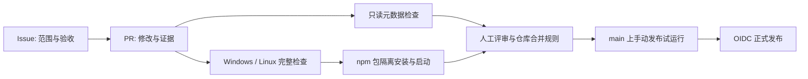

# Agent Repo 的基础建设：从工作约定到可核验的交付

初稿：2026-10-15 · oh-my-quant · 工程实践补篇

给 Agent 一份编码原则，可以减少无关改动；要求它提交前测试，也能改善交付。但仓库一旦开始接受多个 PR、跨平台构建和包发布，维护者仍会遇到同一个问题：这次“完成”到底对应哪个问题、哪份代码，以及哪些检查？

这次为 oh-my-quant 增加 CI 和 npm 发布流程，暴露出的缺口比两个 YAML 文件更具体。原有 Desktop 流程覆盖了 Windows 安装包，却没有独立的 PR 检查入口；Issue 与 PR 的关系主要依靠约定；本地构建成功，也没有独立证明 npm 包离开源码目录后能启动。因此，我们把这次修改限定为仓库质量管理：从问题定义开始，直到产生可检查的发布候选。

## 先决定每一种文件负责什么

一个功能模块对应一个实现 Issue，再由一个实现 PR 交付，这是本仓库选择的工作方式。它让范围、验收和代码评审能够互相定位。跨模块的独立需求应拆分；必须跨越的集成点则在 Issue 中解释。这个约定不能证明修改足够小，也不能靠统计目录数自动判断，需要评审者确认。

文件之间的分工可以直接列出来：

| 载体 | 保存的内容 | 不应据此推断的结论 |
| --- | --- | --- |
| `AGENTS.md` | 长期原则、适用范围、规范与 Skill 入口 | Agent 必然遵守、GitHub 已禁止违规合并 |
| Issue | 复现或使用场景、模块范围、验收条件 | 已有代码实现或验证结果 |
| PR | 具体修改、文档、测试证据、风险与回滚 | 填写完整就等于行为正确 |
| Skill | 创建 Issue、实施与检查 PR 的操作步骤 | 已配置远端自动化 |
| Workflow | 事件、权限、环境、可执行检查 | 仓库规则已将结果设为 required |
| 当前 `docs/` | 当前行为与维护操作 | 过去每次运行都可复现 |
| 技术博客 | 问题、取舍、机制与证据限制 | 替代当前维护规范 |

这也解释了为什么不把所有内容都堆进 `AGENTS.md`：Issue 的进度会变化，测试输出属于某个修订，发布凭证属于外部配置。它们的生命周期不同，集中复制会造成多处事实不同步。

## 两个参考仓库怎样分配检查责任

本篇读取了 OpenAI Codex 的 `81aee8c86ba25` 和 DeepSeek Harness 的 `571902028a75`，以下链接固定到这些提交。公开工作流能说明代码中的触发、权限与检查关系；我们没有检查它们的私有凭证、组织 ruleset，也没有据此声称每项检查都是实际生效的合并条件。

Codex 将合并前检查集中到 `blocking-ci.yml`，通过可复用工作流执行 Bazel、Rust、SDK、仓库规则等检查，最后由 `CI required` 汇总依赖结果。汇总任务即使遇到上游失败也会执行，避免依赖失败后只留下一个跳过的结果。工作流说明还区分了 PR 的合并候选检查与合并后的完整跨平台检查。这种拆分服务于反馈时延与覆盖范围之间的取舍，不意味着每个小仓库都需要同样的矩阵。[汇总入口](https://github.com/openai/codex/blob/81aee8c86ba2549e53f82ea56f163c3e450fb55a/.github/workflows/blocking-ci.yml) · [检查策略](https://github.com/openai/codex/blob/81aee8c86ba2549e53f82ea56f163c3e450fb55a/.github/workflows/README.md)

它的 Issue 自动化还有另一层分工：模型生成分类建议，后续任务负责应用标签；重复问题检测生成候选提示，供人判断是否重复。这里值得借鉴的是把判断输出与仓库写操作分开，并分别声明权限。自动分类不应被当作代码通过验收的证据。[标签流程](https://github.com/openai/codex/blob/81aee8c86ba2549e53f82ea56f163c3e450fb55a/.github/workflows/issue-labeler.yml) · [重复问题提示](https://github.com/openai/codex/blob/81aee8c86ba2549e53f82ea56f163c3e450fb55a/.github/workflows/issue-deduplicator.yml)

DeepSeek Harness 把 Issue policy 与 Issue lifecycle 分成两个工作流。前者读取可信默认分支的策略并验证符合条件的 PR；后者处理项目状态迁移。当前策略区分普通引用与关闭引用：普通引用建立上下文，关闭引用还可能触发 Project Priority 的核对。因此，它并没有采用本仓库“一份 PR 只关闭一个实现 Issue”的完整规则，不能把两者写成同一种制度。[Issue 管理说明](https://github.com/deepseek-ai/deepseek-harness/blob/571902028a75c64c1d767f4ae5fd099485f0ddf0/.github/issue-management/README.md) · [只读策略检查](https://github.com/deepseek-ai/deepseek-harness/blob/571902028a75c64c1d767f4ae5fd099485f0ddf0/.github/workflows/issue-policy.yml) · [生命周期处理](https://github.com/deepseek-ai/deepseek-harness/blob/571902028a75c64c1d767f4ae5fd099485f0ddf0/.github/workflows/issue-lifecycle.yml)

它的 PR 模板在每种测试方法下面保留 Proof 区域，让结果跟着验证方法出现。CI 则拆出静态检查、覆盖率、消费者兼容性和 Windows 原生行为等任务，再汇总成稳定的结果名称。这样的设计有一个实际好处：测试命令、它覆盖的行为和可复核输出更容易对应。[PR 模板](https://github.com/deepseek-ai/deepseek-harness/blob/571902028a75c64c1d767f4ae5fd099485f0ddf0/.github/pull_request_template.md) · [PR CI](https://github.com/deepseek-ai/deepseek-harness/blob/571902028a75c64c1d767f4ae5fd099485f0ddf0/.github/workflows/ci.yml)

oh-my-quant 当前没有必要引入模型分诊、Project 同步或大型 runner 调度。我们先建立一条可解释、可运行的最短流程：

图中流程表示责任关系。合并规则和 npm Trusted Publisher 需要维护者在平台配置；工作流文件不会自动替他们完成设置。

## 质量检查要覆盖用户拿到的东西

新 CI 调用统一的 `check:release`：类型、架构、仓库策略回归、测试组织、完整测试、构建和文档检查。Windows 使用原生 PowerShell，Linux 使用同一套可运行的脚本入口；没有把源码路径写进工作流，后续调整目录时可以继续维护 `package.json` 的命令。

第一次 Linux 运行提供了一个实际反例：CLI 的凭证回归把根路径写死为 `C:\private-paper`。Windows 上测试能走到缺少凭证的分支，Linux 却先拒绝这个非绝对路径。修正是让 fixture 通过 `resolve()` 得到当前平台的绝对路径，保留凭证断言和生产代码。扩展平台检查由此找到了测试自身的环境假设；不能把它写成产品鉴权缺陷，也不应该靠跳过用例恢复绿色。[失败运行](https://github.com/yangjingo/oh-my-quant/actions/runs/38602368594) · [修正的回归](../../src/cli/test/alpaca-paper-entry.test.ts)

构建之后还有一次包验证：`npm pack` 生成 tarball，将它安装到源码目录之外，再用 Node 执行安装包的版本命令。这个检查针对的是“仓库能启动，用户安装的包却缺文件”一类问题。它没有调用行情源或模型，也没有证明交互终端、安装脚本和所有受支持 Node 版本都正确。

文档检查同样需要明确对象。仓库已有一些历史文章链接到被忽略的 `output/` 回执；干净克隆不应该被要求带有这些本地文件。本次只将仓库内 `output/` 的缺失回执列为未重新验证，源码、现行文档、导航与锚点仍须存在。反例测试覆盖相邻目录、越界路径和伪装的 `output/../docs/` 路径，防止扩大豁免范围。

发布操作单独放在手动工作流里：只接受 `main` 上与清单一致的稳定版本，默认 dry run，先等待完整 CI；真正上传时使用 npm OIDC 与 provenance。发布前还运行已有 `prepublishOnly`，重新生成 insights 并执行完整 gate。这会重复部分检查，当前接受这个成本，以保持 npm 生命周期入口独立可用。以后若运行成本明显上升，可以评估直接发布已经验证的同一 tarball，但那需要额外证明制品来源与复用关系。

dry run 不验证 npm 的 OIDC 绑定；provenance 也不证明包的业务结果正确。它们分别回答包能否按流程准备、发布来源如何关联的问题。[发布操作规范](../quant-harness/ci-release.md) · [npm Trusted Publishing](https://docs.npmjs.com/trusted-publishers/)

## AGENTS.md 保留什么，如何避免越来越长

DeepSeek Harness 的根 `AGENTS.md` 保留仓库结构、命令、持久化兼容性与测试规则，并把细节链接到所属文档；`.github/AGENTS.md` 则维护 Windows shell、平台检查归属和 runner 路由。根级约束与目录级操作要求分开，是一个可借鉴的组织方式。它还明确采用“本地做相关检查、CI 承担完整矩阵”的策略；本仓库当前要求提交前运行完整 gate，两者是不同选择。[根级说明](https://github.com/deepseek-ai/deepseek-harness/blob/571902028a75c64c1d767f4ae5fd099485f0ddf0/AGENTS.md) · [GitHub 目录说明](https://github.com/deepseek-ai/deepseek-harness/blob/571902028a75c64c1d767f4ae5fd099485f0ddf0/.github/AGENTS.md)

在本次读取的 Codex 提交中，根目录没有 `AGENTS.md`，存在局部目录说明。例如 TUI bottom pane 的文件要求改状态机时同步模块文档，并核对 Enter、换行与粘贴行为仍符合代码。这个例子说明规则可以贴近需要它的模块，不能根据通用印象补写一个不存在的根文件。[局部说明](https://github.com/openai/codex/blob/81aee8c86ba2549e53f82ea56f163c3e450fb55a/codex-rs/tui/src/bottom_pane/AGENTS.md)

我们的根文件保留两部分：先写编码原则，再写仓库写作规范与 Skill 索引。原则要求说明假设、实现简单、限制改动、定义验收；Issue 与 PR 的详细步骤放入对应 Skill。临时日志、模型推理过程、每次运行的通过数、凭证和项目进度都不进入根文件。出现稳定的目录特有规则时，再增加局部说明。

这次增加的 PR policy 只检查可以明确执行的条件：一条规范关闭引用、真实且开放的 Issue、规定章节、`docs/` Markdown 更新，以及没有另一个遵循相同引用格式的活跃实现 PR。它读取可信基线策略，不执行 PR 中的代码。章节有文字不代表证据充分；改了 docs 不代表更新正确；单模块范围与 UI 效果仍须评审。这些限制应出现在规范里，而不能留给一个绿色标记暗示。

## 当前落地与后续判断

本篇随 Issue #17 的实现 PR 交付。已增加本地可执行的策略回归、工作流定义、模板、当前维护文档和 Agent 指南；远端检查结果以该 PR 最终提交的 Actions 为准。首次引入的可信基线 PR policy 要在进入基线后才会自动处理后续 PR，本 PR 另行执行策略验证。本文不把未合并的定义称为已启用的仓库治理。

后续最值得观察的是具体失败：PR 是否还会缺少问题定位，打包检查能否抓住发布缺文件，文档是否继续依赖私有回执。确认存在重复成本后，再决定是否增加版本矩阵、自动分诊或更细的范围检查。新的规则应对应一个已知风险，并明确失败时由谁处理。

## 实现索引

- [Issue #17](https://github.com/yangjingo/oh-my-quant/issues/17)、[AGENTS.md](../../AGENTS.md)、[Issue Skill](../../.agents/skills/issue-skill/SKILL.md)、[PR Skill](../../.agents/skills/pr-skill/SKILL.md)。
- [CI](../../.github/workflows/ci.yml)、[PR policy](../../.github/workflows/pr-policy.yml)、[npm 发布](../../.github/workflows/npm-publish.yml)。
- [策略实现](../../.github/scripts/pr-policy.mjs)、[反例测试](../../.github/scripts/quality.test.mjs)、[当前维护规范](../quant-harness/ci-release.md)。

[返回技术博客目录](./README.md)
